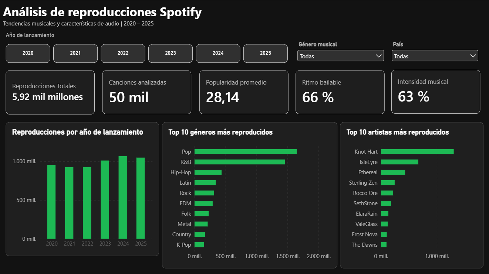
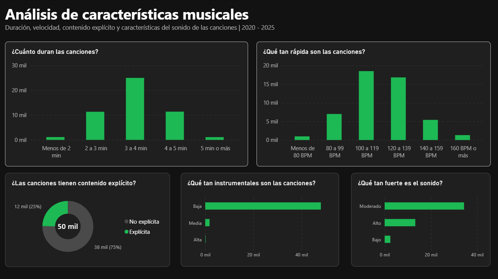
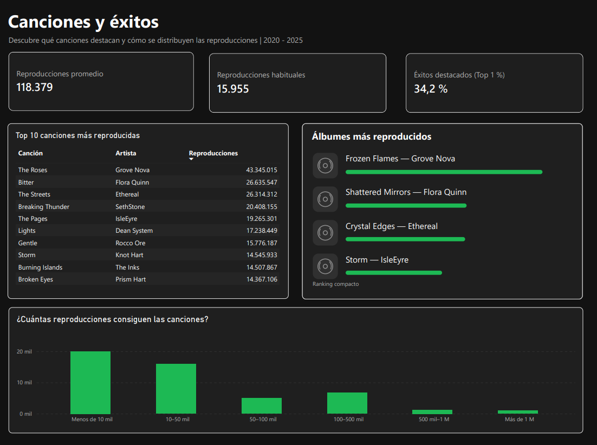
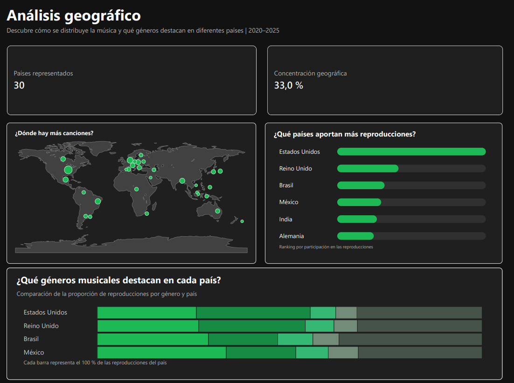

# 🎧 Spotify Streaming Analysis

### Una mirada a las canciones, sus características y la concentración de reproducciones

**Lanzamientos 2020–2025 · 50 mil canciones · Python / SQL / Power BI**

¿Las reproducciones se reparten entre muchas canciones o se concentran en unos pocos éxitos? Este proyecto explora un conjunto de datos musicales y presenta sus resultados en un dashboard de cuatro páginas, pensado para entender los números sin conocimientos de análisis de datos.

> **Alcance de esta documentación.** Las cifras generales y los nombres de las páginas se verificaron en capturas del resumen de Power BI. Los indicadores de canciones y países fueron suministrados por el autor. No estuvieron disponibles los archivos originales del proyecto ni las capturas `images/01.png` a `images/04.png`; por eso, la metodología, las rutas internas y el orden de esas imágenes quedan pendientes de verificación.

## 📊 El proyecto en cifras

| Indicador | Resultado |
| :--- | ---: |
| Años de lanzamiento incluidos | 2020–2025 |
| Canciones analizadas | 50 mil |
| Reproducciones totales | 5,92 mil millones |
| Popularidad promedio | 28,14 |
| Ritmo bailable | 66 % |
| Intensidad musical | 63 % |

El ritmo bailable y la intensidad describen características de las canciones: **no son porcentajes de personas que bailan o prefieren cierta música**. La escala de popularidad y el cálculo exacto de estos indicadores deben confirmarse con el modelo y la documentación de los datos.

## 🔎 Preguntas y resultados clave

| Pregunta | ¿Qué muestran los datos disponibles? |
| :--- | :--- |
| ¿Cuántas reproducciones tiene una canción como referencia? | El promedio es **118.379** y la mediana, **15.955**, según los indicadores suministrados. La mediana representa el punto central al ordenar las canciones por reproducciones. |
| ¿Qué peso tienen los mayores éxitos? | El **1 % de canciones con más reproducciones concentra el 34,2 % del total**: aproximadamente un tercio. |
| ¿Qué géneros encabezan el resumen? | **Pop y R&B** ocupan los primeros lugares del gráfico de reproducciones por género visible en la captura. |
| ¿Cómo se distribuyen las reproducciones por país del registro? | Se reportan **30 países** y una participación del **33,0 % para los tres primeros**. Entre los países destacados se indican US, GB, BR, MX, IN y DE. |

**La principal conclusión:** el promedio es aproximadamente **7,4 veces la mediana**. Junto con la participación del Top 1 %, esto muestra una distribución concentrada: unas pocas canciones con muchas reproducciones elevan el promedio. Para describir una canción situada en el centro del conjunto, la mediana aporta una referencia más útil.

## 🛠️ Metodología y trazabilidad

El proyecto se presenta como un análisis con Python, SQL y Power BI. El detalle que puede documentarse con la evidencia disponible es el siguiente:

| Herramienta o etapa | Estado de verificación |
| :--- | :--- |
| **Datos crudos y procesados — CSV** | No disponibles. Pendiente confirmar fuente, columnas, cantidad exacta de filas y diferencias entre versiones. |
| **Python / Jupyter** | Notebooks no disponibles. Pendiente documentar las transformaciones, exploraciones y resultados realmente ejecutados. |
| **SQL** | Consultas no disponibles. Pendiente confirmar las preguntas resueltas, el motor utilizado y los resultados. |
| **Excel** | No se encontró un libro disponible. Su participación en el análisis queda por confirmar. |
| **Power BI** | Se verificó visualmente el resumen general y las pestañas del informe. Sin el archivo del modelo no se pudieron auditar las medidas, relaciones ni filtros internos. |

## 🖥️ Las cuatro páginas del dashboard

Las siguientes referencias usan las rutas de imágenes indicadas por el autor. **Pendiente: comprobar que cada archivo corresponda a la página asignada antes de publicar.**

### 01 · Resumen General

Presenta las cifras principales, las reproducciones agrupadas por año de lanzamiento y los diez géneros y artistas con más reproducciones. La captura revisada muestra filtros de año de lanzamiento, género musical y país.

### 02 · Análisis musical

Página dedicada al análisis musical. Su nombre está confirmado en las pestañas del informe; los gráficos y comparaciones específicos quedan pendientes de revisión de la captura correspondiente.

### 03 · Canciones y éxitos

Los indicadores suministrados permiten comparar **promedio: 118.379**, **mediana: 15.955** y **participación del Top 1 %: 34,2 %**. Juntos ayudan a entender cuánto pesan los mayores éxitos en el resultado global.

### 04 · Análisis geográfico

Los datos suministrados incluyen **30 países**, un **33,0 % de participación del Top 3** y los códigos destacados **US, GB, BR, MX, IN y DE**: Estados Unidos, Reino Unido, Brasil, México, India y Alemania. También se indicó una comparación de **US, GB, BR y MX**, con los grupos **Pop, R&B, Hip-Hop, Rock y Otros**; su presentación visual queda pendiente de verificar.

> **Cómo interpretar el país:** sin un diccionario de datos, `country` solo puede describirse como el país asociado al registro. No permite afirmar dónde viven los oyentes, desde dónde escuchan ni cuál es la nacionalidad del artista.

## 💡 Hallazgos y límites

- **Los éxitos tienen un peso elevado:** el Top 1 % reúne aproximadamente un tercio de las reproducciones reportadas.
- **Promedio y mediana cuentan historias distintas:** su diferencia muestra por qué conviene consultar ambos indicadores.
- **Pop y R&B lideran el ranking visible del resumen**, sin que esto demuestre que el género cause más reproducciones.
- **2020–2025 corresponde a años de lanzamiento.** El gráfico no demuestra cómo evolucionó la escucha durante esos años, porque no se verificó la fecha de cada reproducción.
- Los resultados describen este conjunto de datos. Su origen, fecha de extracción, representatividad y posible carácter sintético no pudieron comprobarse; no deben generalizarse a todo Spotify.
- Los valores del dashboard pueden estar redondeados. Falta revisar duplicados, datos faltantes, canciones únicas, fórmulas y el criterio exacto usado para seleccionar el Top 1 %.

## 📁 Estructura y cómo explorar el proyecto

Esta es una **guía de archivos por localizar**, no un inventario verificado del repositorio:

| Archivo o material | Para qué consultarlo |
| :--- | :--- |
| `README.md` | Entender el alcance, los resultados y sus límites. |
| `images/01.png` a `images/04.png` | Recorrer las capturas del dashboard; rutas indicadas por el autor. |
| Notebooks `.ipynb` — **ruta pendiente** | Revisar el análisis en Python y sus salidas. |
| Consultas `.sql` — **ruta pendiente** | Revisar las preguntas y cálculos realizados con SQL. |
| CSV crudos y procesados — **rutas pendientes** | Comparar los datos de origen con los utilizados en el informe. |
| Informe Power BI — **ruta pendiente** | Explorar las páginas, filtros y medidas del modelo. |
| Libro Excel — **existencia y ruta pendientes** | Consultar su aporte al proyecto, si corresponde. |

Para una primera lectura, empieza por los resultados clave y después recorre las cuatro páginas. Para reproducir el análisis, será necesario localizar los archivos anteriores, documentar las dependencias de Python y el motor SQL, ejecutar los notebooks en su orden real y actualizar las conexiones de Power BI. Al validar los resultados, usa la misma selección de filtros que las capturas.

**La reproducción completa queda pendiente de verificar con los archivos originales.** No se incluyen comandos ni instrucciones de instalación que no hayan sido comprobados.

## ⚙️ Tecnologías

**Python · Jupyter Notebook · SQL · Power BI · Markdown**  
Excel: uso pendiente de confirmar. Las bibliotecas de Python, el motor SQL y las versiones se documentarán al revisar los archivos del proyecto.